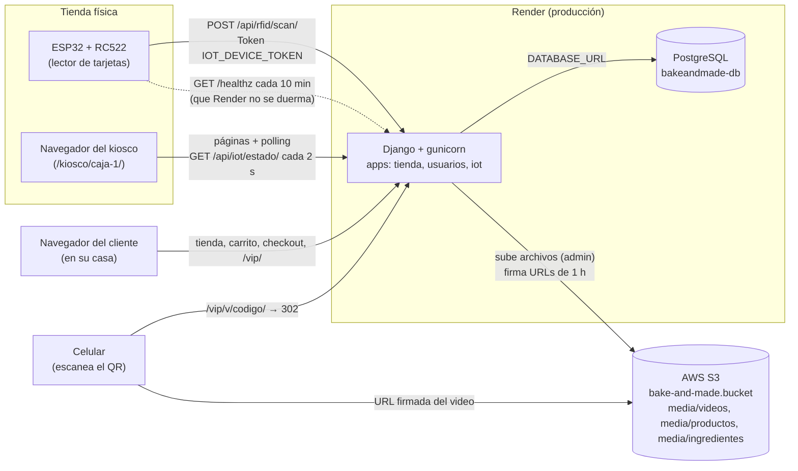
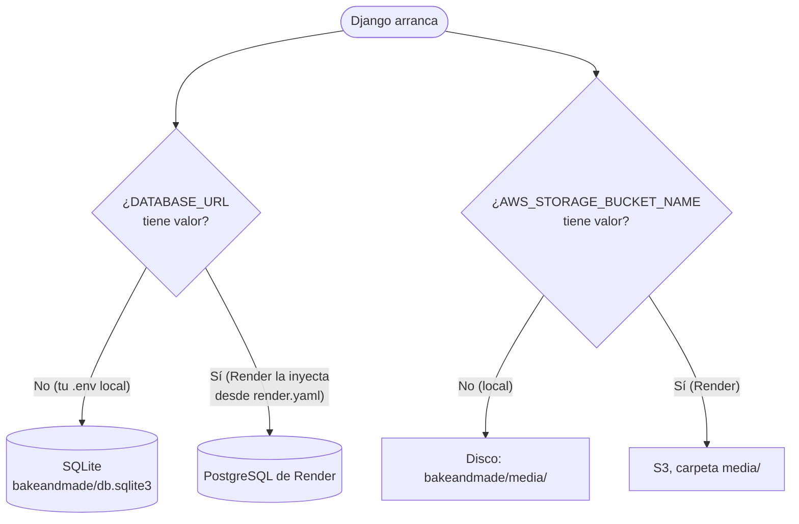
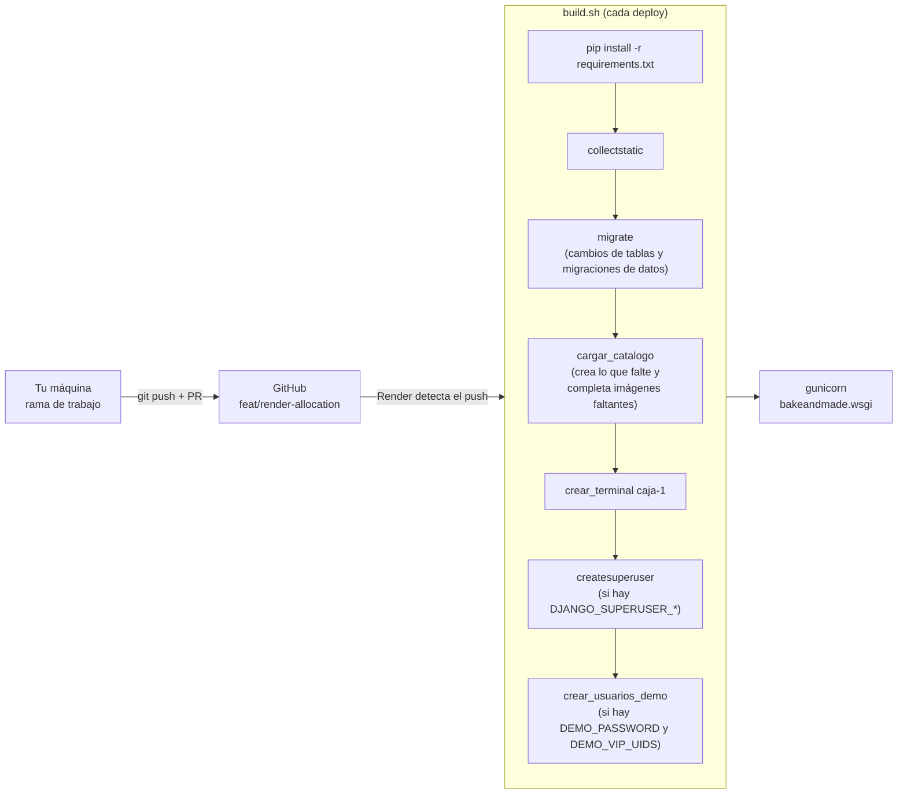
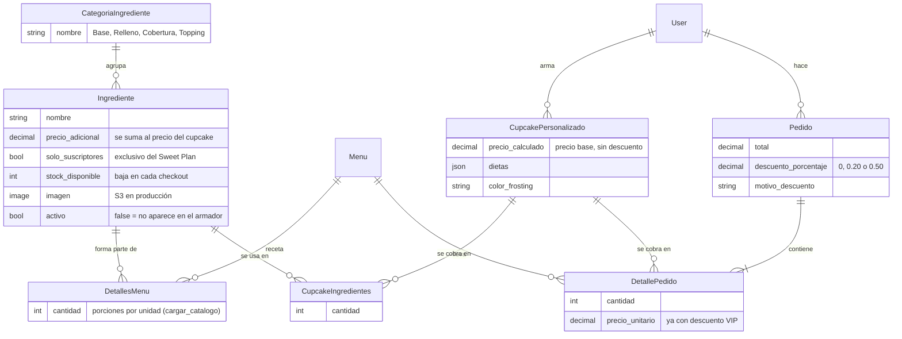
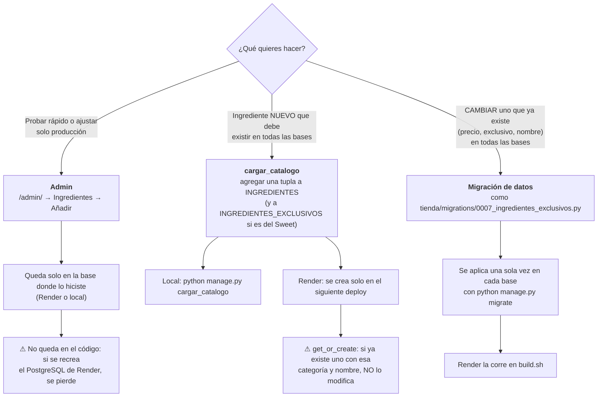
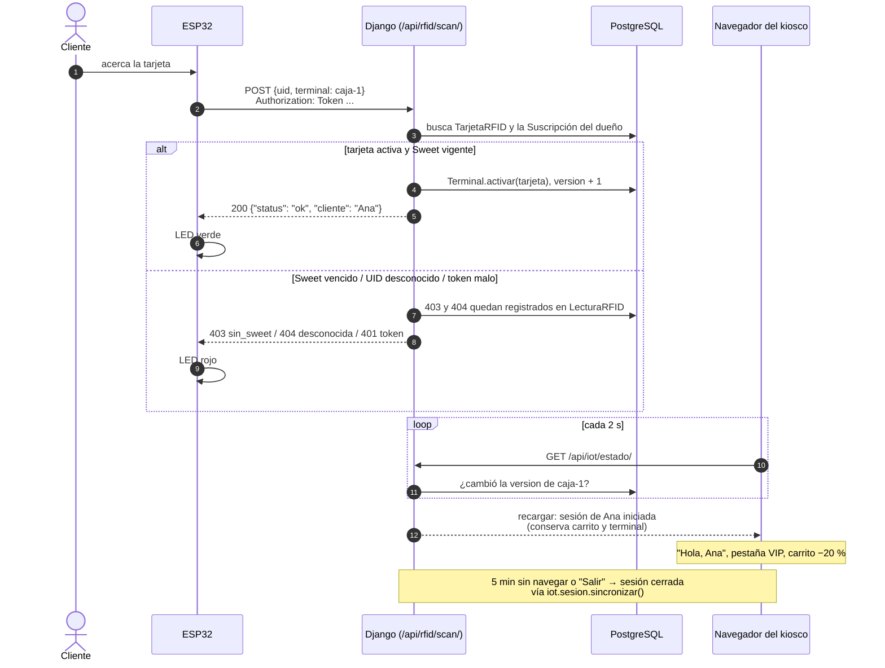
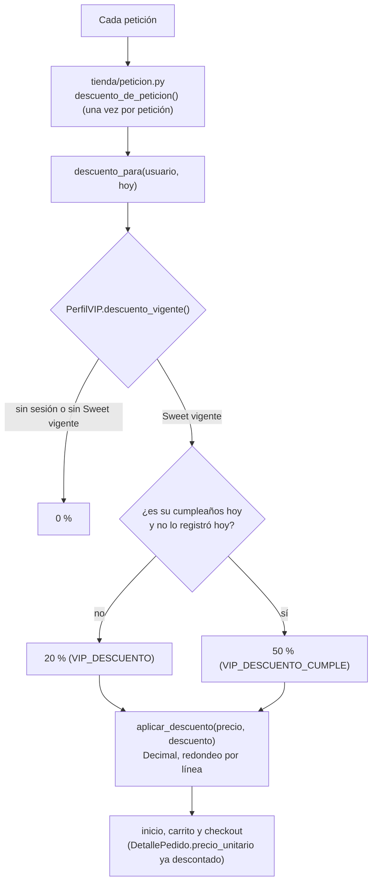

# Diagramas del sistema

Vista rápida de cómo está armado Bake & Made. Los diagramas usan [Mermaid](https://mermaid.js.org/): GitHub los dibuja solo y en VS Code basta la extensión *Markdown Preview Mermaid Support*. Las reglas de código siguen en [ARCHITECTURE.md](ARCHITECTURE.md), el detalle de la capa VIP en [IOT_VIP_SPEC.md](IOT_VIP_SPEC.md) y la descripción completa del sistema en [sistema-actual.md](sistema-actual.md).

## 1. Panorama: quién habla con quién

El ESP32 **nunca** habla con el navegador: solo le dice a Django qué tarjeta leyó. El kiosco se entera preguntando cada 2 s.

## 2. Dos entornos, dos bases de datos

Una sola línea de `settings.py` decide qué base se usa: si `DATABASE_URL` tiene valor, se usa esa; si está vacía, SQLite.

| | Local (WSL) | Render |
|---|---|---|
| Base de datos | SQLite (`db.sqlite3`) | PostgreSQL (gratuito, **vence a los 30 días**) |
| Imágenes y videos | `bakeandmade/media/` | S3 (`media/`) |
| Variables | `.env` (python-dotenv) | Panel **Environment** del servicio |
| `DEBUG` | `True` | `False` |
| Usuarios demo | `python manage.py crear_usuarios_demo` | `build.sh` en cada deploy |

**Las dos bases no se sincronizan.** Lo que hagas en el admin local no aparece en Render y al revés. Por eso, en la fase 10, los usuarios demo creados en local no servían para el ESP32: él consulta la base de Render.

## 3. Del commit a producción

Todos los pasos del build son **idempotentes**: se pueden repetir en cada deploy sin duplicar nada. `firmware/` no participa en el despliegue; se carga a mano con `cargar.ps1` o `cargar.sh`.

## 4. Ingredientes: modelo de datos

El checkout **nunca** cobra con los precios guardados en la sesión: `Pedido.objects.personalizados_validos()` vuelve a leer cada ingrediente de la base (precio, `activo`, stock y si es exclusivo del Sweet).

## 5. Cómo agregar o cambiar ingredientes

Hay tres caminos, y la diferencia es **en qué bases queda el cambio**:

Regla práctica:

- **Ingrediente nuevo del catálogo** → agrégalo en `tienda/management/commands/cargar_catalogo.py` y haz deploy. Si ya alguien lo creó en el admin de Render con la misma categoría y nombre, no pasa nada: `get_or_create` lo encuentra y no lo duplica.
- **Cambiar precio o volver exclusivo uno que ya existe** → el admin basta si solo importa producción; si debe valer en todas las bases (incluida una nueva), escribe una migración de datos como `0007`.
- **Imagen del ingrediente** → agrega el archivo a `media/ingredientes/` (`git add -f`) y su ruta a `IMAGENES_INGREDIENTES`; el build la sube a S3. También se puede subir en el admin, y esa manda.
- **Ingredientes agregados en el admin de Render** que quieras conservar → cópialos también a `INGREDIENTES` en `cargar_catalogo.py`, para que no se pierdan si la base de Render se recrea.

## 6. Inicio de sesión con la tarjeta VIP

## 7. De dónde sale el descuento

